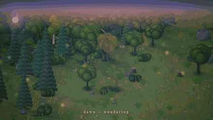

# 🫎 Moose

**An endless, generative forest — and a moose who lives in it.**



Moose is a single-file, zero-dependency HTML canvas toy. Open it and watch a procedurally generated woodland unfold while a moose wanders, drinks, eats, bathes and sleeps through a full day/night cycle. There's nothing to click — just let it run.

## Run it

No build, no install:

```sh
git clone https://github.com/ChrisBrooksbank/moose.git
cd moose
# then open index.html in any modern browser
```

## Features

- **Endless world** — terrain, lakes, meadows, and mixed woodland generated from seeded noise
- **A living moose** — wanders, wades, drinks, grazes, bathes and beds down to sleep
- **Day and night** — a continuous cycle from dawn light and mist through starry nights
- **Calm by design** — a gentle fade-in, soft captions describing what the moose is doing, and a hidden cursor

## Tweaking via URL parameters

| Parameter | Example | Effect |
| --- | --- | --- |
| `day` | `?day=120` | Seconds per full day (default `420`) |
| `speed` | `?speed=2` | Simulation speed multiplier |
| `time` | `?time=0.5` | Starting time of day, `0`–`1` (default `0.20`) |
| `force` | `?force=drink` | Jump straight to a behaviour: `bathe`, `drink`, `eat`, `sleep` |
| `lake` | `?lake` | Start beside a lake |
| `debug` | `?debug` | Show moose state in the page title |

Combine them: `index.html?day=90&time=0.75&force=sleep`

## Tech

Plain HTML, CSS and vanilla JavaScript drawing to a 2D `<canvas>`. One file, no dependencies.
